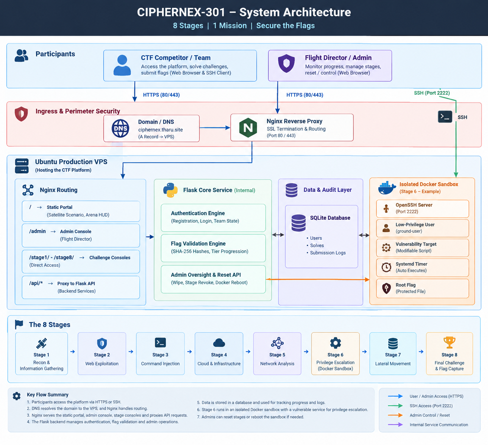

# CipherNex-301  | Space Security CTF Play Box

[](https://ubuntu.com/)
[](https://www.docker.com/)
[](https://nginx.org/)
[](https://flask.palletsprojects.com/)

🚀 **Live Demo:** [ciphernex.tharu.site](https://ciphernex.tharu.site)

**CipherNex-301** is an 8-stage interactive Capture The Flag (CTF) security challenge platform built for the SLIIT *Penetration Testing (IE3132)* module (Group 45). It simulates the unexpected reactivation of a decommissioned experimental satellite acting as a covert Command & Control (C2) relay.

Players progress through a realistic space-security narrative while solving challenges spanning OSINT, network forensics, memory forensics, cryptography, steganography, Linux privilege escalation, and hybrid network-crypto analysis.

**Flag format:** `CIPHERNEX{snake_case_string}` (case-sensitive)

---

## Table of Contents

- [Overview](#overview)
- [Team & Responsibilities](#team--responsibilities)
- [Architecture](#architecture)
- [Challenge Stage Matrix](#challenge-stage-matrix)
- [Host Prerequisites](#host-prerequisites)
- [Deployment from Scratch](#deployment-from-scratch)
- [Project Structure](#project-structure)
- [Usage](#usage)
- [Admin Console](#admin-console)
- [Reset & Maintenance](#reset--maintenance)
- [Testing](#testing)
- [Rules of Engagement](#rules-of-engagement)
- [Known Limitations](#known-limitations)
- [License](#license)

---

## Overview

CipherNex-301 is a self-hosted, multi-stage CTF platform with:

- Nginx reverse-proxy routing (TLS on port 443)
- Flask API backend with SQLite for users, solves and submission logs
- Email/password team accounts
- Sequential stage unlocking (stage *N+1* unlocks after stage *N* is solved)
- Docker-isolated Stage 6 privilege-escalation sandbox (SSH on port 2222)
- SHA-256 flag validation (flags are stored only as hashes)
- Admin console for team progress, submission logs and resets

Each stage hands artifacts to the next, so the chain has to be solved in order.

---

## Team & Responsibilities

| Admission No. | Member | Role | Component & Deliverables |
|---|---|---|---|
| IT24102307 | Dewmith H. L. T. P | Platform & Infrastructure | Architecture diagram, Nginx TLS proxy, UFW firewall design, Flask API, SQLite schema, Stage 6 isolation, Admin Console (`admin.html`) |
| IT24100387 | De Zoysa T. N. D. | Challenge Design A | **Stages 1-4**: OSINT (`STG-01`), UDP stream reconstruction (`STG-02`), memory forensics (`STG-03`), KDF cryptography (`STG-04`), generation scripts and validation |
| IT24100284 | Jayaratne M. Y. I. De S. | Challenge Design B | **Stages 5-8**: audio steganography (`STG-05`), Stage 6 Dockerfile/systemd-style exploit (`STG-06`), C2 stream analysis (`STG-07`), capstone pipeline (`STG-08`) |
| IT24103238 | G. K. Sedara Ransiluni | Integration, QA & Reporting | Test execution, risk matrix, reset script engineering, master report and annexure logs |

---

## Architecture



- **Participants** reach the portal through Nginx on HTTPS (443).
- **Flask backend** (`Backend/server.py`, port 5000 behind Nginx) serves the portal, stage pages and artifacts, validates flags and records progress.
- **Static stages (1-5, 7, 8)** are downloadable artifacts under each stage's `files/` folder.
- **Stage 6** is the only interactive stage: a Docker container exposing SSH on host port 2222, with resource limits, no Docker socket and no host volume mounts.
- **UFW** allows only TCP 443 and 2222 from outside.

---

## Challenge Stage Matrix

| Stage | Code    | Title                        | Domain                | Difficulty | Points |
|:-----:|:-------:|------------------------------|-----------------------|:----------:|:------:|
| **1** | `STG-01` | Skywatch                    | OSINT / Recon         | Easy       | 100    |
| **2** | `STG-02` | Broken Beacon               | Networking            | Easy       | 150    |
| **3** | `STG-03` | Memory of the Ground Station| Memory Forensics      | Moderate   | 250    |
| **4** | `STG-04` | Orbital Cipher              | Cryptography          | Moderate   | 300    |
| **5** | `STG-05` | Hidden in the Noise         | Steganography         | Moderate   | 350    |
| **6** | `STG-06` | Service Ghost               | Linux Security        | Mod-Hard   | 400    |
| **7** | `STG-07` | Command Chain               | Networking + Crypto   | Hard       | 500    |
| **8** | `STG-08` | Final Downlink              | Capstone / Hybrid     | Hard       | 600    |

**Total possible points:** 2650 (per the project specification; hints may reduce points).

---

## Host Prerequisites

- Ubuntu 24.04 LTS (x86_64) recommended; the code also runs locally on Windows/macOS/Linux for development
- Root / sudo access
- 4-8 vCPU / 8-16 GB RAM recommended for a full VPS deployment (a laptop with 2 vCPU / 4 GB is enough for local testing)
- Python 3.9+ and Docker
- Public IP + domain (optional but recommended for HTTPS)

---

## Deployment from Scratch

### 1. Install System Packages

```bash
sudo apt update && sudo apt install -y \
  git \
  nginx \
  python3 \
  python3-pip \
  python3-venv \
  docker.io \
  curl \
  ufw
```

### 2. Clone the Repository

```bash
git clone https://github.com/TharuPinsara/CipherNex-301.git
cd CipherNex-301
```

### 3. Set Up Python Environment

There is no `requirements.txt`; the backend needs only Flask and Flask-CORS.

```bash
python3 -m venv venv
source venv/bin/activate        # Windows: venv\Scripts\activate
pip install flask flask-cors gunicorn
```

Quick local run (development):

```bash
python Backend/server.py        # http://localhost:5000
```

The SQLite database (`Backend/ctf.db`) and tables are created on first start.

### 4. Run Flask as a Service (production)

Create `/etc/systemd/system/ciphernex-api.service` (adjust paths and user):

```ini
[Unit]
Description=CipherNex-301 API
After=network.target

[Service]
User=ciphernex
WorkingDirectory=/opt/ciphernex/Backend
ExecStart=/opt/ciphernex/venv/bin/gunicorn -w 2 -b 127.0.0.1:5000 server:app
Restart=always

[Install]
WantedBy=multi-user.target
```

```bash
sudo systemctl daemon-reload
sudo systemctl enable --now ciphernex-api
```

> The Stage 6 reset route calls `docker`, so the service user needs permission to run Docker commands.

### 5. Configure Nginx

Create `/etc/nginx/sites-available/ciphernex`:

```nginx
server {
    listen 80;
    server_name your-domain;
    return 301 https://$host$request_uri;
}

server {
    listen 443 ssl;
    server_name your-domain;

    ssl_certificate     /etc/letsencrypt/live/your-domain/fullchain.pem;
    ssl_certificate_key /etc/letsencrypt/live/your-domain/privkey.pem;

    location / {
        proxy_pass http://127.0.0.1:5000;
        proxy_set_header Host $host;
        proxy_set_header X-Real-IP $remote_addr;
        proxy_set_header X-Forwarded-For $proxy_add_x_forwarded_for;
    }
}
```

```bash
sudo ln -s /etc/nginx/sites-available/ciphernex /etc/nginx/sites-enabled/
sudo nginx -t && sudo systemctl reload nginx
```

Certificates can be issued with Let's Encrypt (`certbot`).

### 6. Build & Start Stage 6 Sandbox

```bash
cd challenges/stage6
chmod +x reset-stage6.sh
./reset-stage6.sh
```

The script rebuilds the `stage6-serviceghost` image and starts the `stage6-box` container with `-p 2222:22`, `--memory=512m`, `--cpus=1.0` and `--restart unless-stopped`. No Docker socket or host volumes are mounted.

### 7. Firewall Rules

```bash
sudo ufw default deny incoming
sudo ufw allow 443/tcp
sudo ufw allow 2222/tcp
# keep your own admin SSH access (restrict it to your IP)
sudo ufw enable
```

Port 5000 stays bound to localhost and is not exposed.

---

## Project Structure

```
CipherNex-301/
├── Backend/
│   ├── server.py                  # Flask API, flag validation, routing
│   └── ctf.db                     # SQLite database (generated, git-ignored)
├── Stage 1/ ... Stage 8/
│   ├── Web/Stage-N/               # Stage page (index.html), files/, Fonts/
│   └── generate_*.py, *.py        # Artifact generators (Stages 3, 4, 5)
├── challenges/
│   └── stage6/                    # Dockerfile, entrypoint, sync job, reset-stage6.sh
├── tests/                         # Security, reset and test-suite scripts, results
├── Logos/                         # Branding assets
├── index.html                     # Main portal
├── admin.html                     # Admin console
├── architecture.png               # Architecture diagram
├── .gitignore
└── README.md
```

---

## Usage

1. Open the root portal (`http://localhost:5000/` locally, or `https://your-domain/`).
2. Register a team account, then log in.
3. Progress sequentially through the eight stages (`/stage1/` ... `/stage8/`).
4. Download each stage's artifacts and submit the flag from the stage page.
5. Stage 6: connect over SSH on port 2222 using what you gathered earlier.

Artifact generators (optional, files are already included):

```bash
pip install pycryptodome        # Stage 4; Stage 5 also needs steghide installed
python "Stage 3/generate_memory_dump.py"
python "Stage 4/generate_enc.py"
python "Stage 5/generate_stage5.py"
```

Copy any regenerated file into the matching `Stage N/Web/Stage-N/files/` folder.

---

## Admin Console

Available at `/admin`. Sign in with the seeded admin account defined in `Backend/server.py` (`init_db`). **Change the default password before any shared or public deployment.**

Features:
- Team progress overview (members, flags captured, stages solved)
- Latest flag submission logs (team, stage, status, IP, time)
- Reset a team's progress entirely, or revoke a stage and everything after it
- One-click Stage 6 container reset

---

## Reset & Maintenance

| Action | How |
|---|---|
| Reset a team's progress | Admin console, or `POST /api/admin/reset-team-all` with `team_name` |
| Revoke a stage onward for a team | Admin console, or `POST /api/admin/reset-team-stage` with `team_name`, `stage_id` |
| Reset Stage 6 | Admin console, `POST /api/admin/reset-stage6`, or `./challenges/stage6/reset-stage6.sh` |
| Wipe all data | Stop the service and delete `Backend/ctf.db` (recreated on next start) |

---

## Testing

Scripts in `tests/`:

| File | Purpose |
|---|---|
| `test_unintended_solutions.py` | Out-of-order flag lockout, SQL injection on the flag API, plaintext-flag check on the memory dump, Stage 6 root file permissions |
| `test_reset_recovery.py` | Platform reset and Stage 6 recovery |
| `run_test_suite.py` | Runs the modules and writes `tests/test_results.log` |
| `test.md` | Manual test case table (TC-01 to TC-08) |

```bash
python Backend/server.py &      # start the platform first
python tests/run_test_suite.py
```

---

## Rules of Engagement

**Permitted:** interacting only with the assigned platform endpoint (443) and Stage 6 (2222); analysing artifacts offline; exploiting the intentionally vulnerable service inside the Stage 6 container; using the designated reset controls.

**Prohibited:** scanning or attacking the host VPS, SLIIT infrastructure or public networks; DoS, brute-force flooding or high-volume scanning; container breakout or host mounting attempts; sharing flags, keys or credentials between teams.

---

## Known Limitations

- `/api/admin/*` routes have no server-side authentication; restrict them at the proxy (for example by IP) or add token checks before exposing the platform.
- Login does not issue a session token or JWT; progress calls trust the `team_name` and `user_id` sent by the client.
- `tests/run_test_suite.py` references `solutions/test_integration.py`, which is not in the repository.
- Stage 6 simulates a root timer with a 30-second loop on an `ubuntu:22.04` image rather than running real systemd.

---

## License

This project is intended for educational and authorized CTF use only.  
Unauthorized deployment against third-party systems is strictly prohibited.

---
